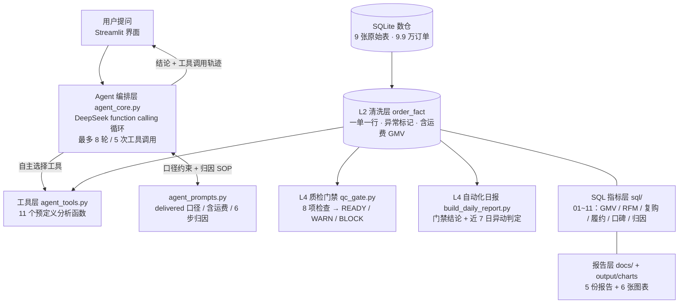

# Olist 电商经营分析 Agent

> 用自然语言问经营问题，Agent 自己决定查哪些数据、查几次、怎么归因。
> 10 万条巴西电商真实订单 · 11 个 SQL 分析工具 · DeepSeek function calling · 全程 0 服务器成本

---

## 这是什么

一个**能对话的经营分析 Agent**，不是报表工具。

用户问「2018 年 GMV 为什么停止增长？」——它不会直接作答，而是自己走完一遍归因：
拆同环比 → 看新客/存量结构 → 下钻品类地域 → 验证假设 → 才下结论。

**那 11 个分析工具是给模型用的，不是给人点的。** 调哪几个、调几次、什么时候停，由模型自己判断。

## 核心结论 Top 5

1. **2018 年 GMV 停滞的根因是获客引擎失速**：月新客数 2018-01 见顶（6,842）后回落 10%，而平台 97% 的收入依赖新客首购、复购率仅 3.0% —— 已用排除法排除品类结构与体验恶化
2. **物流是差评第一大主因（35.8%）**：LLM 分析 1,000 条葡语评论 + 统计证据（1 星订单迟到率 37.9%）三角验证闭环
3. **隐性风险**：迟到率 6.5% → 9.3%（2017→2018），履约在变快但承诺在变激进——口碑的慢性毒药
4. **LLM 能力边界地图**：情感判断"极端可靠、中间模糊"（1/5 星一致率 93%+，3 星仅 12%）→ 落地方案：置信度路由
5. **数据陷阱实战**：同一订单多条评价（551 单，另有重复 review_id 814 条）、地理表冗余（52.6 行/前缀）、采集截尾误判为业务崩盘——**先质检后分析，且已落成可执行门禁**

## 链路损耗地图（运营视角）

同一批数据有两个入口。**分析视角**是 11 个模块各自回答一个问题；**运营视角**是把它们排成一条链路：

```
下单          99,441 单   ← 全部订单
  │   −2.98%   失效：canceled 625 / unavailable 609 / 卡在途中 1,722
有效履约      96,478 单   97.02%
  │   −8.11%   迟到：7,826 单晚于承诺送达日
准时送达      88,652 单   91.89%（占已履约）
  │   −12.81%  差评：1–2 星 12,273 / 已评价 95,832
好评(4–5星)   75,643 单   78.93%（占已评价）
  │   −97.00%  不复购：绝大多数客户只买一次
复购客户       2,801 人   / 93,358 人 = 3.00%
```

| 环节 | 核心指标 | 实测 | 相对上一步 | 归因入口 |
|---|---|---|---|---|
| 下单 → 履约 | 失效订单率 | **2.98%** | — | `sql/02` 订单状态 · QC-05 |
| 履约 → 准时 | 迟到率 | **8.11%** | −8.11% | `sql/07` 履约时效 · `get_delivery_performance` |
| 准时 → 好评 | 差评率（已评价口径） | **12.81%** | −12.81% | `sql/08` 口碑 · P4 LLM 差评归因 |
| 好评 → 复购 | 复购率（人级口径） | **3.00%** | −97.00% | `sql/05` 复购 · `sql/09` 增长拆解 |

**这张图的价值不在数字，在于它把"分析"翻译成了"运营语言"：**

- 分析视角问「GMV 为什么停？」，运营视角问「**链路哪一段在漏，漏了多少**」
- 最大漏点被一眼定位：**不是履约（2.98%）、不是迟到（8.11%），是复购（3.00%）**
- 这个判断与原结论（97% 收入依赖新客首购）互相印证，但**从链路视角看更直观、更像运营该说的话**

> 表中所有数字都由 `build_fact_table.py` 生成的 `order_fact` 宽表直接算出，可复现。

## 架构



## 仓库结构

```
olist-analysis/
├── data/                      # 9 张原始 CSV（来源见「数据获取」，已 gitignore）
├── sql/                       # 01~11 分析模块（每个含口径说明注释）
├── docs/                      # 5 份报告：质检 / 经营分析 / 归因 / LLM 情感 / 显著性检验
├── output/                    # SQL 结果 CSV + charts/ 6 张图
├── reports/                   # 自动生成的日报（Markdown）
│
│   ── 数据层 L2 ──
├── import_to_sqlite.py        # CSV → SQLite 入库 + 5 项快速质检
├── build_fact_table.py        # ★ 9 表合并成订单宽表 order_fact（去重/归一/打标）
├── schema_profiler.py         # ★ 列画像：推断数值/日期/维度，建议 sum 还是 avg
├── qc_gate.py                 # ★ 质检门禁：8 项检查 → READY / WARN / BLOCK
├── run_sql.py                 # SQL 模块运行器（跑模块 + 导出 CSV）
│
│   ── 自动化层 L4 ──
├── build_daily_report.py      # ★ 任意日期生成日报：门禁结论 + 异动判定 + 归因指引
│
│   ── 分析层 ──
├── sentiment_analysis.py      # LLM 情感分析 + 幻觉验证（交叉比对真实评分）
├── delivery_significance_test.py  # 配送时效 × 评分的显著性检验（P5 报告）
├── make_charts.py             # 6 张图表生成
│
│   ── Agent 层 ★ ──
├── agent_core.py              # 决策循环：function calling + 防失控护栏
├── agent_tools.py             # 11 个分析工具 + JSON Schema 注册表 + 调度器
├── agent_prompts.py           # 口径规则 + 6 步归因 SOP + 回答规范
├── app.py                     # Streamlit 界面（含工具调用轨迹展示）
├── 启动助手.bat               # 双击启动（Windows）
└── requirements.txt
```

## 快速开始

### 1. 准备数据

从 Kaggle 下载 [Brazilian E-Commerce Public Dataset by Olist](https://www.kaggle.com/datasets/olistbr/brazilian-ecommerce)，
把下面 9 个 CSV 放进 `data/`：

```
olist_customers_dataset.csv
olist_geolocation_dataset.csv
olist_order_items_dataset.csv
olist_order_payments_dataset.csv
olist_order_reviews_dataset.csv
olist_orders_dataset.csv
olist_products_dataset.csv
olist_sellers_dataset.csv
product_category_name_translation.csv
```

### 2. 建库 + 跑分析

```bash
pip install -r requirements.txt
python import_to_sqlite.py      # 建库 + 质检（打印重复率 / 时间范围 / 状态分布）
python build_fact_table.py      # L2 清洗：9 张表 → 订单宽表 order_fact
python schema_profiler.py       # 可选：查看宽表的列画像（接新数据时用）
python qc_gate.py               # L4 门禁：不通过则不该继续出数（退出码 0/1/2）
python build_daily_report.py    # L4 日报：输出 reports/daily_YYYY-MM-DD.md
python run_sql.py               # 11 个模块 → output/*.csv
python make_charts.py           # 图 1~4
```

### 3. 跑 LLM 评论分析（可选，图 5/6 依赖它）

```bash
echo sk-xxxxxxxxxxxxxxxx > .api_key
python sentiment_analysis.py    # 1,000 条葡语评论 → 情感标签 + 幻觉验证
python make_charts.py           # 重新生成全部 6 张图
```

### 4. 启动 Agent

```bash
# 双击启动（Windows）
启动助手.bat

# 或手动
streamlit run app.py                              # 浏览器界面
python agent_core.py "2018年GMV为什么停止增长？"   # CLI 单次提问（打印工具轨迹）
python agent_core.py                              # CLI 交互模式
```

## 一次真实交互

```
你 > 复购率是多少？这说明什么？

🔍 推理过程（调用 1 次工具）
  1. get_repurchase_rate  参数: {}
     total_customers  repeat_customers  repeat_rate_pct
     93358            2801              3.0

助手 > 复购率 3.0%（人级口径：93,358 个客户里只有 2,801 人下过 2 单以上）。

     这说明平台几乎是**一次性交易结构**。配合「新客贡献 97% GMV」一起看，
     含义更清楚：收入完全依赖拉新，老客池不产生复购。
     所以当 2018 年月新客数从 6,842 见顶回落到约 6,100（-10%）时，
     GMV 没有第二台引擎接住——这就解释了 2018 年的增长停滞。

     建议：把预算从纯拉新切一部分到首单后 30 天内的复购激励上。
```

## 数据质检门禁

`qc_gate.py` 把质检从"报告里的一段话"变成"跑得起来的一道闸"：

```bash
python qc_gate.py        # 退出码 0=READY  1=WARN  2=BLOCK
```

本数据集上的实测输出：

```
【门禁项】
QC-01 唯一性/同一订单多条评价      551 单 (0.56%)                    WARN
QC-04 完整性/履约时间字段缺失       缺失率 0.01%                      READY
QC-05 一致性/支付记录无对应订单      0 单 (0.000%)                     READY
QC-07 时效/近期数据完整性(截尾)     近30天送达率 0.0% vs 全期 97.0%    WARN
QC-08 异常值/支付金额负值/零值      负值 0 条，零值 9 条，P99.9 以上 104 条  WARN

【信息项 · 只报告不阻塞】
QC-01b 重复 review_id            814 条（与订单级口径不同，勿混用）
QC-02 维度表冗余(地理)            52.6 行/前缀
QC-03 主键粒度歧义               customer_id 99,441 vs unique_id 96,096
QC-06 GMV 口径差额              含运费 15,419,774 vs 不含 13,221,498（差 14.26%）

门禁结果: WARN
```

**一个关键设计取舍**：8 项检查里只有 5 项参与门禁，另外 3 项只报告不阻塞。

因为它们是**数据集的固有属性**——geolocation 天然 52.6 行/前缀、两种客户键天然有差异、
GMV 两口径天然差 14.26%。这些不是"本批数据出错"，处理方式已固化在分析层。
**若把它们也纳入门禁，每次都会 WARN，门禁就失去意义。门禁要抓的是"本批数据的异常"，不是"已知的数据特征"。**

## 接入新数据：列画像

换成一张不认识的表，Agent 就不知道该对哪列求和、按哪列分组。`schema_profiler.py` 解决这个：

```bash
python schema_profiler.py                 # 默认画像 order_fact
python schema_profiler.py olist_orders    # 指定表
python schema_profiler.py --tables        # 列出所有表
```

在 `order_fact` 上的实际判断（节选）：

| 列 | 推断类型 | 唯一值 | 角色 | 聚合建议 |
|---|---|---|---|---|
| `gmv` | number | 27,376 | 指标 | **sum** |
| `days_to_deliver` | number | 5,036 | 指标（时长类） | **avg** |
| `review_score` | number | 5 | 指标（率/均价类） | **avg** |
| `is_late` | number | 2 | 比例/标记 | **avg**（0-1 取均值得百分比）|
| `customer_state` | text | 27 | 维度 | 可 group by |
| `customer_unique_id` | text | 96,096 | 高基数列 | 不建议直接分组 |

**三条判定规则，都是启发式、都可能错，所以输出里带"角色"让你复核：**

1. **80% 阈值**推类型：80% 以上能解析成数字 → `number`；能匹配日期 → `date`；否则 `text`
2. **名称含「率 / 均 / 评分 / 单价」或「天 / 时长 / days」** → 求平均，不求和
3. **0/1 二值列** → 按比率处理。`is_late` 求和会得到 7,826 这个没有意义的数，求平均才是 8.11%

第 3 条是最容易翻车的地方，也是这套规则与前人实现的最大差异——**"看起来是数字"不等于"应该求和"**。

## 自动化日报（L4）

```bash
python build_daily_report.py                 # 默认取数据内最新日 −30 天（避开采集截尾）
python build_daily_report.py 2018-08-15      # 指定日期
```

输出 `reports/daily_YYYY-MM-DD.md`：当日概览 + 近 7 日异动判定 + 归因指引 + 数据说明。

示例（2018-08-15）：

| 指标 | 近 7 日 | 前 7 日 | 变化 | 判定 |
|---|---|---|---|---|
| GMV | ¥298,665 | ¥343,927 | −13.2% | ⚠️ 异动 |
| 下单量 | 1,826 | 2,195 | −16.8% | ⚠️ 异动 |
| AOV | ¥167.60 | ¥161.39 | +3.8% | 正常 |
| 迟到率 | 8.47% | 15.77% | −7.29pp | ⚠️ 异动 |

**两个设计判断（都可以被质疑，所以写清理由）：**

1. **异动判定用 7 日均线，不用单日环比。** 实测单日 GMV 环比中位 19.6%、P90 52.5%——单日阈值会天天报警；7 日均线环比 P90 = 9.3%，故取 8% 作 WARN 线。
2. **差评率不进当日结论。** 评价相对下单有滞后，日粒度会系统性低估，只在 7 日窗口给参考值。

## 设计取舍

这一节是项目里最值得看的部分——**每个决定都有代价，下面把代价也写出来。**

### 1. 为什么给模型 11 个预定义工具，而不是让它自由写 SQL？

- **自由写 SQL** 换来灵活性，代价是把"口径正确"交给模型临场判断。而它并不知道：
  `delivered` 才是成交口径、`customer_id` 是"人×单"级（用错会把回头客算成新客）
- **预定义工具**把口径焊死在 SQL 里，模型只能在正确口径上调参数
- **代价**：问到 11 个工具覆盖不到的问题，它只能答"我查不了"
- 若将来要放开，最小安全集是：只读连接 + 强制 `LIMIT` + 表白名单 —— 本版未做

### 2. 为什么把数据口径和归因 SOP 写进 system prompt？

因为这四个坑在数据里真实存在，靠模型自觉必踩：

| 坑 | 后果 |
|---|---|
| 评价表重复（814 条） | 评分分布失真 |
| geolocation 冗余（52.6 行/前缀） | JOIN 后行数爆炸 |
| `customer_id` ≠ `customer_unique_id` | 回头客被算成新客，复购率归零 |
| 2018-09/10 采集截尾 | **把"没采到数据"判成"业务崩盘"** |

最后一条最危险，所以 prompt 里写的是**否定指令**：明确禁止据此下负面结论。

### 3. 为什么用 Streamlit，而不是 React + FastAPI？

- 这个项目要验证的是「Agent 能否正确归因」，不是前端工程能力
- Streamlit 一个文件解决界面 + 会话状态，复杂度全部让给 Agent 层
- **代价**：不能多用户、不能公开部署、无鉴权

## 已知局限

- **单数据集**：表结构写死在工具里，接新数据要改代码
- **图表离线**：`make_charts.py` 生成静态 PNG，不在对话里出图
- **无测试**：验证靠人工跑 CLI，没有自动化回归
- **靠手动执行**：`qc_gate.py` 与 `build_daily_report.py` 均需手动跑，尚未挂定时任务
- **日报基于历史快照**：数据集截止 2018-10-17，日报只能对历史日期生成，没有实时增量接入
- **无并发控制**：只适合本地单人使用

## 报告

- [Olist 经营分析报告](docs/Olist经营分析报告.md)
- [P1 数据质检报告](docs/P1_数据质检报告.md)
- [P3 归因分析报告](docs/P3_归因分析报告.md)
- [P4 LLM 情感分析报告](docs/P4_LLM情感分析报告.md)
- [P5 配送时效与评分的显著性检验](docs/P5_配送时效与评分的显著性检验.md)

## 技术栈

SQLite · SQL（窗口函数 / CTE / TEMP TABLE / 索引）· Python（pandas / requests / matplotlib / streamlit）· DeepSeek function calling · Prompt 工程 · 统计验证
